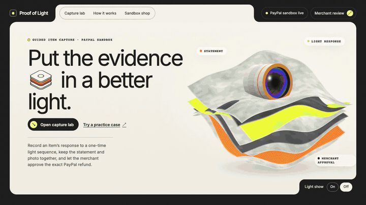
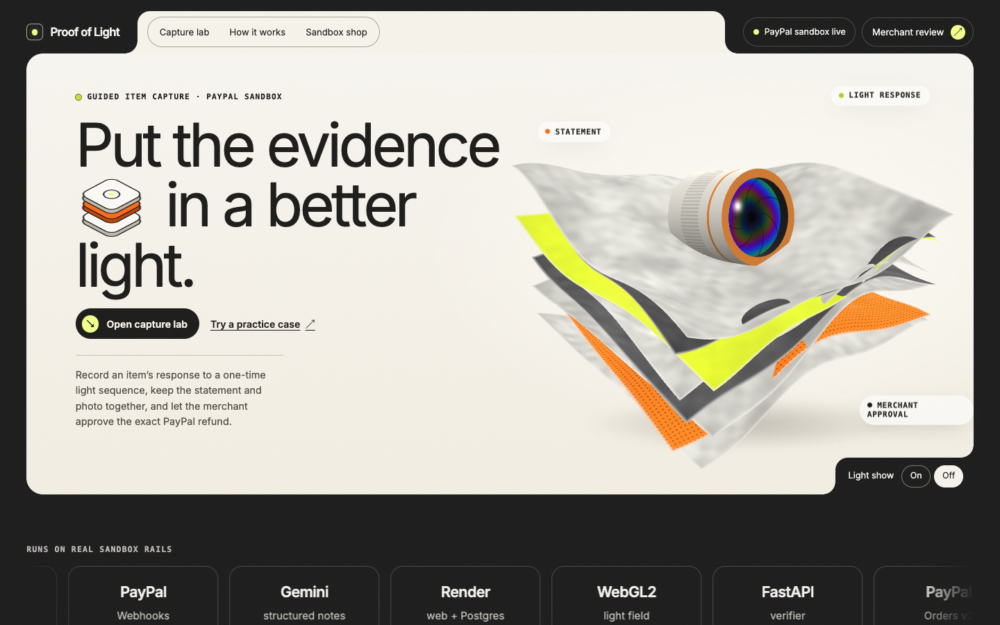
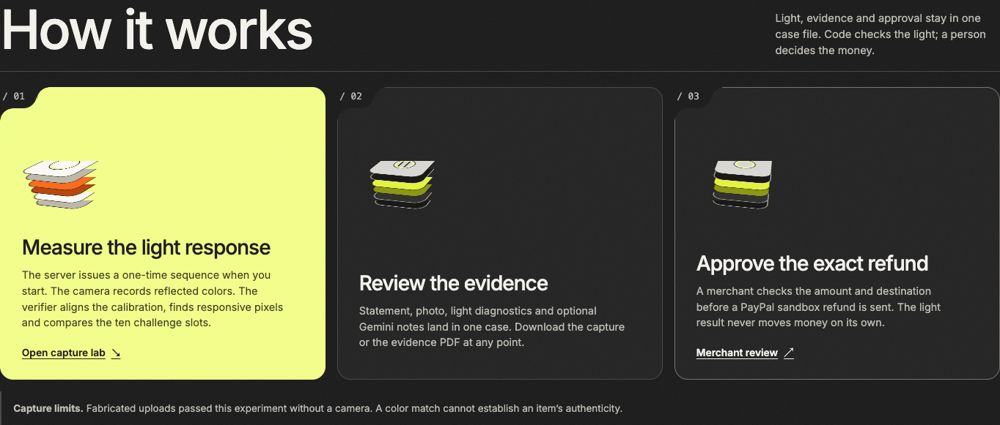
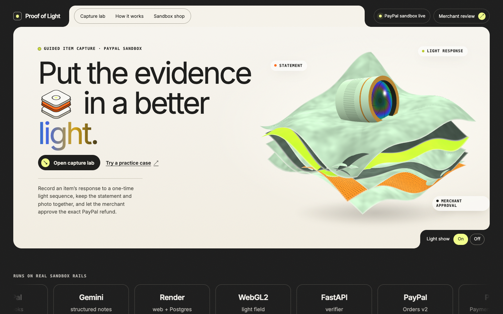
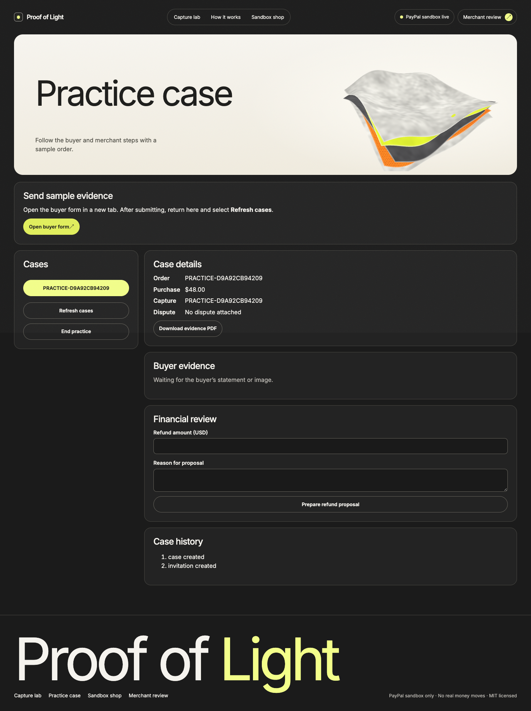
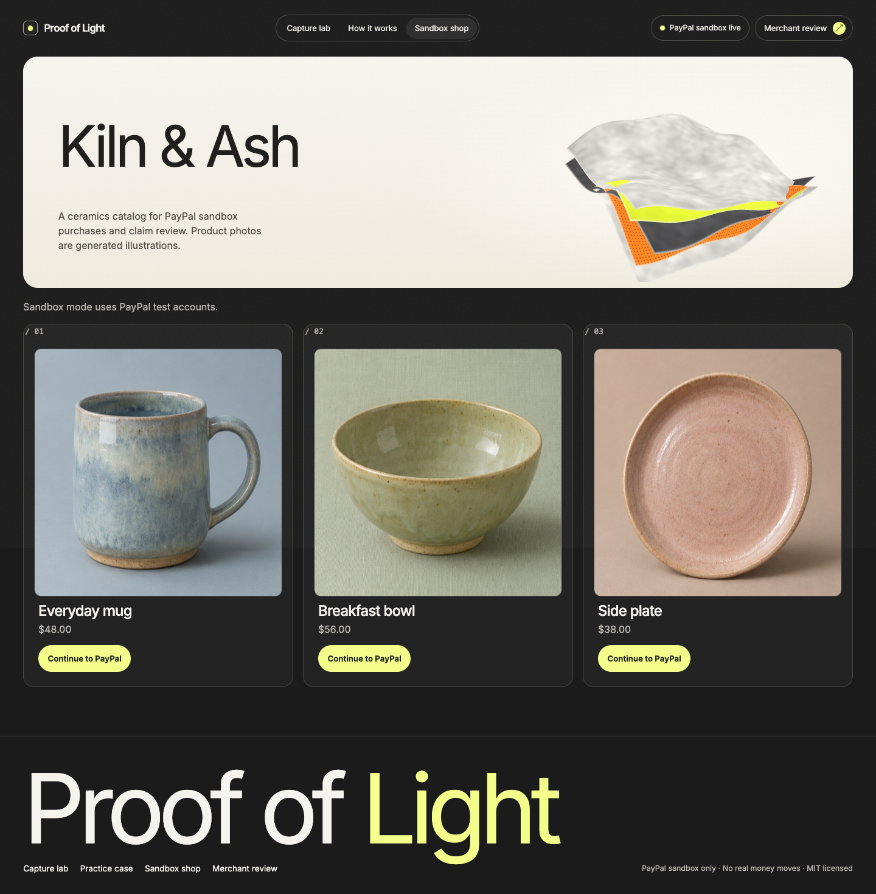
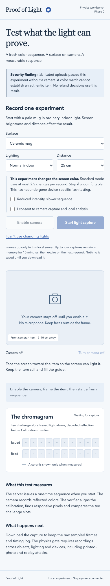

# Proof of Light

Proof of Light helps buyers submit item evidence and gives merchants a case file to review before a refund. A buyer can record a guided light response, upload a photo, or send a statement. The merchant reviews the exact amount and destination before sending a PayPal sandbox refund.

**Live demo: [proof-of-light-hjpt.onrender.com](https://proof-of-light-hjpt.onrender.com)** · PayPal sandbox only, no real money moves. The free Render instance may take up to a minute to wake after idling.



The practice flow runs without login or provider keys. PayPal checkout and refund tests use stubbed responses; the hosted site uses PayPal sandbox credentials kept server-side. The [product brief](docs/PRODUCT_BRIEF.md) describes the capture-assistance scope.

## Try it in two minutes

1. Open [Try a practice case](https://proof-of-light-hjpt.onrender.com/practice) and select **Start practice case**. No login or keys are needed.
2. Select **Open buyer form**, write a short statement, tick the sharing consent and send the evidence. A guided light capture is optional and needs a camera.
3. Back on the practice tab, refresh the case, download the evidence PDF, prepare a refund and approve the exact amount. Practice approvals are saved locally and never call PayPal.
4. The [sandbox shop](https://proof-of-light-hjpt.onrender.com/shop) opens PayPal's real sandbox approval page for a test purchase.

| Landing | How it works | Light show |
| --- | --- | --- |
|  |  |  |

| Merchant practice case | Sandbox shop | Phone |
| --- | --- | --- |
|  |  |  |

The hero is an original raw WebGL2 scene, and the layer icons are CSS 3D; [DESIGN.md](DESIGN.md) covers the reference, the motion rules and the fallbacks.

## Run locally

Use Python 3.12 from the repository root.

```sh
python3.12 -m venv .venv
.venv/bin/python -m pip install -r requirements-dev.lock -e .
.venv/bin/python scripts/init_local.py
.venv/bin/alembic upgrade head
.venv/bin/python -m uvicorn apps.api.main:app --host 127.0.0.1 --port 8000
```

Open [Try a practice case](http://127.0.0.1:8000/practice) to send sample evidence, download the PDF, and approve a fictional refund. Each practice case has its own one-hour session. For the authenticated merchant workflow, use the steps below.

1. Open [Merchant review](http://127.0.0.1:8000/merchant). Enter `POL_MERCHANT_TOKEN` from the ignored `.env` file.
2. Select **Create practice case**, then **Create buyer link**. Open the invitation in a separate tab.
3. Send a statement with an optional photo or guided capture. Refresh the merchant case to review the evidence and download its PDF.
4. Prepare a refund proposal and check the amount and destination before approving. A practice case saves the approval locally.

The [sandbox shop](http://127.0.0.1:8000/shop) uses prices from the server. With sandbox credentials, it opens PayPal’s approval page, captures an approved payment after the buyer returns, and lists the completed order in merchant review. That order can become a case. See [sandbox and deployment setup](docs/DEPLOY.md).

## How the pieces connect

```text
PayPal sandbox purchase or dispute
               |
               v
     Merchant case and invitation
               |
               v
    Buyer statement + optional image
               |
               v
  Light diagnostics + optional Gemini notes
               |
               v
  Merchant review + version-bound approval
               |
               v
 Explicit send of an approved sandbox refund
```

A merchant approves each refund. The dispatch route rechecks the proposal, case revision and PayPal capture and records the provider’s response. Uncertain outcomes stay open for reconciliation. Imported disputes are reviewed here and resolved in PayPal’s Resolution Center. The [review contract](docs/MERCHANT_REVIEW.md) describes the approval boundary.

| Integration | Use |
| --- | --- |
| PayPal Orders v2 | Create, read, capture and attach tracking to sandbox orders |
| PayPal Payments v2 | Send an explicitly approved USD capture refund |
| PayPal Disputes v1 and Webhooks | List and import disputes and verify event signatures before refreshing case state |
| Gemini | Generate structured condition, uncertainty and follow-up notes for a consented image |
| Render | Blueprint for a same-origin web service and PostgreSQL |

## Capture evidence and limitations

The light result describes the uploaded signal. Item authenticity remains unverified. A local experiment using synthetic uploads reproduced a matching result without a camera, and a weak or absent response leaves the buyer eligible for human review. See the [recorded evidence](eval/reports/2026-11-08-injection.json) and [threat model](docs/THREAT_MODEL.md).

The capture page uses the camera after consent and offers a no-light option. `getUserMedia` needs localhost or HTTPS. Session captures expire from memory. A buyer submission retains the statement, a JPEG and a compact diagnostic report in the case database. AI notes require a separate buyer opt-in and a merchant request.

## Verify

```sh
.venv/bin/python -m pytest -q
.venv/bin/ruff check apps/api packages scripts tests
.venv/bin/alembic check
```

The [browser report](eval/reports/2026-11-12-review-browser.json) uses a simulated camera. Physical camera measurements and live provider behavior are tracked separately in [progress](docs/PROGRESS.md). The [AI tools record](docs/AI_TOOLS.md) covers Codex, APIMatic’s PayPal context and generated catalog art. Source is MIT licensed.
